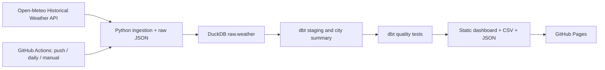

# Peru Weather Observatory

By **Cristhian Carlos Mamani Cori**. An educational, non-commercial data engineering project with no AWS services.

[Public dashboard](https://Cristhian465.github.io/peru-weather-data-pipeline/) · [Automated runs](https://github.com/Cristhian465/peru-weather-data-pipeline/actions)

## Architecture



The pipeline fetches **14 days for Tacna, Lima and Arequipa**. Its window ends seven days before the UTC run date to accommodate reanalysis availability. The API returns gridded reanalysis, not station observations. Daily maximum/minimum temperature and precipitation feed two dbt models. The dashboard metric is the average of daily temperature midpoints, **not** the true daily mean temperature.

## Run locally

Requires Python 3.11 and internet access.

```sh
python -m venv .venv
source .venv/bin/activate
pip install -r requirements.txt
python pipeline/ingest.py
dbt build --profiles-dir .
python pipeline/export.py
python -m http.server 8000 --directory site
```

Open http://localhost:8000. Inspect DuckDB at `data/weather.duckdb`, raw API responses in `data/raw`, and dbt execution evidence in `target/run_results.json`.

## Automated deployment

In repository **Settings → Pages → Build and deployment → Source**, select **GitHub Actions**. Push to `main` or run **Weather pipeline and public dashboard** from Actions. The daily schedule is 11:17 UTC (06:17 Peru); GitHub schedules can be delayed. The build ingests, runs `dbt build`, exports the site, and uploads a Pages artifact. A dependent job publishes it with `actions/deploy-pages`. Only the deploy job receives Pages write and OIDC permissions. No personal tokens, API keys or cloud credentials are needed.

Quality gates check non-null measurements, unique city summaries, unique city/day keys, temperature ordering and bounds, nonnegative rain, exactly 14 days per city, and exactly three cities. Ingestion also checks exact dates and retries network failures. Export refuses to publish unless dbt tests passed. A failure leaves the previously deployed dashboard in place; its timestamp makes freshness visible.

Raw responses, the database and dbt results are retained as a workflow artifact for seven days. Each build replaces the rolling window; this demo is not a persistent historical warehouse. There is no silent fallback to sample data. A source outage fails the run.

## Repository layout

- `pipeline/ingest.py`: fetch, validate, preserve raw JSON and atomically load DuckDB.
- `models/`: SQL transformations and dbt column tests.
- `tests/weather_contract.sql`: dataset contract; any returned row fails the test.
- `pipeline/export.py`: tested static dashboard and downloadable datasets.
- `.github/workflows/pipeline.yml`: scheduled execution and deployment.

## Data and licensing

Weather data: [Open-Meteo](https://open-meteo.com/), [Historical Weather API](https://open-meteo.com/en/docs/historical-weather-api), [CC BY 4.0](https://creativecommons.org/licenses/by/4.0/). The free endpoint is intended for non-commercial use; review current provider terms before expanding this demo. Code is MIT licensed.

## Scope

This small batch workload does not need Kafka or a continuously running Airflow server. dbt expresses model dependencies; GitHub Actions sequences ingestion, transformations, validation and deployment. For larger datasets, add persistent object storage, incremental ingestion, stronger observability, dependency locking and a dedicated orchestrator.
